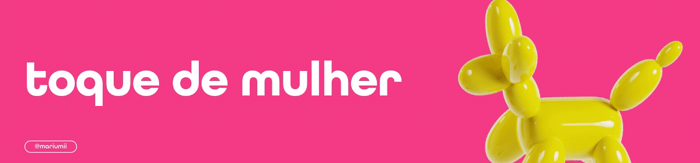

  

  
  
  

## Sobre o Projeto

O **Toque de Mulher** é uma plataforma de e-commerce para cosméticos e cuidados pessoais.

O objetivo do projeto é levar uma operação de varejo de beleza para o digital, com uma loja navegável, gestão de produtos, controle de estoque, pagamentos online e uma experiência de compra mais moderna para a cliente final.

## Status Atual

O projeto já possui uma base sólida de MVP:

- loja navegável com catálogo, busca, carrinho e checkout visual;
- login, cadastro, perfil e endereço;
- área administrativa e cadastro de produto;
- gamificação e refinamentos de identidade visual;
- backend com base para usuários, produtos, pagamentos, fornecedores e estoque;
- documentação organizada por escopo, requisitos, arquitetura, testes, riscos e sprints.

O MVP está **demonstrável**, mas ainda segue em **validação para operação comercial**. Isso significa que a experiência já pode ser apresentada, mas os fluxos de compra, pedido, pagamento, estoque, endereço e produto administrativo ainda precisam ser comprovados de ponta a ponta.

## Repositórios Principais

| Repositório                                                       | Finalidade                                                                  |
| ------------------------------------------------------------------ | --------------------------------------------------------------------------- |
| [Frontend](https://github.com/ToqueDeMulher/toquedemulher-frontend) | Loja virtual, painel administrativo e experiência da usuária              |
| [Backend](https://github.com/ToqueDeMulher/toquedemulher-backend)   | API, regras de negócio, autenticação, estoque, fornecedores e pagamentos |
| [Documentação](https://github.com/ToqueDeMulher/docs)             | Status do projeto, sprints, requisitos, arquitetura, testes e roadmap       |

## Leitura das Sprints

| Sprint    | Principal avanço                                                               |
| --------- | ------------------------------------------------------------------------------- |
| Sprint#01 | Base do projeto, documentação inicial e estrutura técnica                    |
| Sprint#02 | Autenticação, checkout, pagamento, dashboard e consolidação do MVP          |
| Sprint#03 | Busca, endereço, tema, acessibilidade, segurança e início do estoque         |
| Sprint#04 | Fornecedores, estoque, associação fornecedor-produto e controle admin         |
| Sprint#05 | Integração, identidade visual, autenticação e refinamentos de layout        |
| Sprint#06 | Planejamento de fechamento, evidências e validação ponta a ponta             |
| Sprint#07 | Revisão final de julho, documentação atualizada e pendências reais mapeadas |

## Participação registrada

A leitura dos commits mostra a seguinte distribuição histórica:

- **Maria:** maior participação em frontend e documentação;
- **Carolina:** consolidação técnica mais recente da documentação;
- **Gabriel Soares:** contribuições em navegação e endereço;
- **João Pedro:** contribuições em tema e acessibilidade;
- **Matheus Musashi:** correções de segurança e dependências no backend.

Também há contribuições anteriores relevantes de **Gustavo Henrique** no backend e de **João Gabriel** na busca. Ambos não fazem mais parte do grupo atual.

## Tecnologias

  
  
  
  
  
  

## Equipe atual

<table align="center">
  <tr>
    <td align="center">
      <a href="https://github.com/Marichoii">
         
        <b>Maria Eduarda</b>
      </a> 
      Projeto · Frontend · Docs
    </td>
    <td align="center">
      <a href="https://github.com/MatheusMusashiTanaka">
         
        <b>Matheus Musashi</b>
      </a> 
      Backend · Segurança
    </td>
    <td align="center">
      <a href="https://github.com/Jpzin1">
         
        <b>João Pedro</b>
      </a> 
      Tema · Acessibilidade
    </td>
  </tr>
  <tr>
    <td align="center">
      <a href="https://github.com/ccarolmdlima">
         
        <b>Carolina</b>
      </a> 
      Docs · QA
    </td>
    <td align="center">
      <a href="https://github.com/Zouares">
         
        <b>Gabriel Soares</b>
      </a> 
      Navegação · Endereço · UI
    </td>
  </tr>
</table>

---

  Projeto desenvolvido pela equipe <b>Toque de Mulher</b>.

